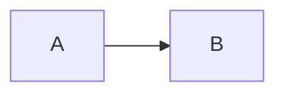

# Note de conception — <projet ou besoin>

> Copier ce fichier dans le repo concerné en `docs/conception/<projet>.md`, le proposer par Pull Request. Approuvée = Conception terminée.

Cadrage : <lien vers la discussion>

## 1. Spécifications fonctionnelles

### Cas d'usage principaux
-

### Règles métier
Cas limites, permissions.
-

### Hors périmètre
-

## 2. Architecture technique

Choix structurants, **justifiés** (pas seulement listés) : stack, composants, intégrations.
Schéma ci-dessous si l'architecture est simple.

Décisions à tracer dans le temps → un ADR dans [`docs/adr/`](../adr) :
- [ADR-0001](../adr/0001-titre.md)

## 3. Découpage en issues

Chaque bloc devient une ou plusieurs issues (titre actionnable, contexte court, critères d'acceptation vérifiables).

| Bloc | Issue | Taille |
|---|---|---|
| | #  | |

## 4. Milestone

Nom : `MVP` — périmètre : toutes les issues ci-dessus.

## 5. Points ouverts et risques
-
